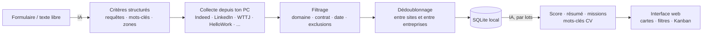

<div align="center">


# JobRadar

**Ton radar personnel d'offres de stage, d'alternance et d'emploi, analysé par IA, entièrement sur ton PC.**


</div>


## Pourquoi JobRadar ?

Chercher un stage, c'est ouvrir dix sites, retaper les mêmes mots-clés, retomber sur les mêmes offres
publiées partout et lire des dizaines d'annonces hors sujet. JobRadar fait ce travail pour toi :

1. **Tu décris ta recherche** avec un formulaire, une phrase (« stage bac+5 de 6 mois en cybersécurité en
   Île-de-France à partir de janvier »), ou les deux.
2. **L'IA en tire une stratégie de recherche** : requêtes FR/EN, intitulés ciblés, mots-clés du domaine,
   mots à exclure. Elle te signale aussi les contradictions. Tu valides ou tu ajustes.
3. **Des robots parcourent les sites d'offres depuis ton PC** : Indeed, LinkedIn, Welcome to the Jungle,
   HelloWork, France Travail et les pages carrières d'entreprises.
4. **Les offres sont filtrées, dédoublonnées, puis analysées par l'IA** : score de pertinence expliqué,
   résumé, missions, profil recherché et **mots-clés à reprendre dans ton CV**.
5. **Tu suis tes candidatures** dans un Kanban, de « Offre consultée » jusqu'à « Retenu ».

L'IA utilisée est **ton propre assistant en ligne de commande** (Claude Code ou Codex), déjà connecté à
ton abonnement. Pas de clé API, pas de serveur distant : tes recherches et tes candidatures restent sur ta machine.

## ✨ Fonctionnalités

| | |
|---|---|
| 🧠 **Analyse des critères par IA** | Formulaire et/ou langage naturel, puis requêtes, mots-clés et exclusions, modifiables avant lancement |
| 🌐 **Multi-sources** | Indeed · LinkedIn · Welcome to the Jungle · HelloWork · France Travail (API officielle) · pages carrières (Greenhouse, Lever, SmartRecruiters) |
| 🧹 **Filtrage et dédoublonnage** | Offres hors domaine ou d'un autre type de contrat écartées avant l'IA ; une même offre publiée sur plusieurs sites n'apparaît qu'une fois, avec tous ses liens |
| 📊 **Score de pertinence expliqué** | Points forts et points faibles, résumé, missions, profil, points d'attention |
| 📝 **Aide au CV** | Mots-clés exacts de l'offre à reprendre (copiables) et conseils d'adaptation |
| 📍 **Zone stricte ou souple** | En mode souple, une offre hors zone reste visible si son score est élevé |
| 🗂️ **Suivi des candidatures** | Kanban par glisser-déposer, vue liste, notes, historique daté, taux de réponse |
| 🔁 **Confirmation automatique** | Quand tu reviens sur JobRadar après avoir ouvert une offre, il te demande si tu as postulé |
| ⏰ **Mise à jour quotidienne** | systemd (Linux) ou Planificateur de tâches (Windows), rattrapée au démarrage si le PC était éteint |
| 🛟 **Résistant aux quotas** | Si ton quota IA est épuisé, les offres non analysées restent en attente et sont reprises le lendemain |
| 🌗 **Thème clair / sombre** | Interface responsive, utilisable aussi sur mobile, aux couleurs de JobRadar (Work Sans, bleu nuit, bleu radar, cyan, vert menthe) |

<table>
<tr>
<td width="50%"></td>
<td width="50%"></td>
</tr>
<tr>
<td align="center"><em>Critères générés par l'IA, modifiables avant lancement</em></td>
<td align="center"><em>Détail d'une offre : score, missions, aide au CV</em></td>
</tr>
<tr>
<td width="50%"></td>
<td width="50%"></td>
</tr>
<tr>
<td align="center"><em>Suivi des candidatures en Kanban</em></td>
<td align="center"><em>Thème sombre</em></td>
</tr>
</table>

<p align="center"><br><em>Version mobile</em></p>

## 🚀 Installation

### 1. Prérequis

- **Python 3.10 ou plus récent** : [python.org](https://www.python.org/downloads/). Sous Windows, coche
  « Add Python to PATH » pendant l'installation.
- **Un assistant IA en ligne de commande, connecté à ton compte** (un seul suffit) :

| Assistant | Abonnement | Installation | Vérification |
|---|---|---|---|
| **Claude Code** | Claude Pro / Max | [docs Claude Code](https://docs.anthropic.com/en/docs/claude-code/overview) | `claude -p "dis bonjour"` |
| **Codex CLI** | ChatGPT Plus / Pro | [github.com/openai/codex](https://github.com/openai/codex) | `codex exec "dis bonjour"` |

> Lance l'assistant une première fois dans un terminal pour te connecter. JobRadar l'utilisera ensuite
> tout seul, en arrière-plan.

### 2. Récupérer le projet et lancer

**Linux / macOS**

```bash
cd JobRadar
./run.sh
```

**Windows** : double-clique sur `run.bat`, ou dans un terminal :

```bat
cd JobRadar
run.bat
```

Le premier lancement crée l'environnement Python et installe les dépendances (1 à 2 minutes). L'interface
s'ouvre ensuite sur **http://127.0.0.1:8765**.

> 🧪 JobRadar a été testé sous **Linux**. Les scripts Windows (`run.bat`, `install_daily.ps1`) et la prise
> en charge de macOS sont fournis mais n'ont pas encore été éprouvés : n'hésite pas à remonter un problème.

### 3. Choisir l'assistant IA

Par défaut, JobRadar utilise **Claude Code**. Pour passer à **Codex**, ouvre `data/config.json` (créé au
premier lancement) et remplace :

```json
"ai_provider": "claude"
```

par

```json
"ai_provider": "codex"
```

Redémarre ensuite JobRadar. Tu peux aussi choisir le modèle par tâche dans `"models"` ; une chaîne vide
utilise le modèle par défaut de l'assistant.

## 🧭 Utilisation

1. **+ Nouvelle recherche** : remplis le formulaire et/ou décris ta recherche, puis clique sur **Analyser**.
2. **Vérifie les critères proposés** : supprime ou ajoute des requêtes, des mots-clés ou des zones (touche Entrée pour ajouter).
3. **Enregistrer et lancer la recherche** : la collecte prend 15 à 30 minutes (les robots marquent des
   pauses pour ne pas surcharger les sites). Les cartes apparaissent au fil de l'analyse.
4. **Clique sur une carte** pour lire l'analyse, puis sur **Voir l'offre et candidater** : l'offre arrive
   dans **Mes candidatures**. À ton retour, JobRadar te demande si tu as postulé.
5. **Fais glisser tes candidatures** d'une colonne à l'autre au fil des réponses (entretien RH, technique, retenu, refusé…).

> 💡 Le filtre « Score ≥ 40 » masque par défaut les offres peu pertinentes et celles pas encore analysées.
> Mets-le à 0 pour tout voir.

## ⏰ Mise à jour automatique quotidienne

Seules les recherches réglées sur **« Quotidienne »** sont actualisées. Le bouton **Actualiser maintenant**
fonctionne pour toutes.

**Linux** (timer systemd utilisateur ; une notification de bureau signale les nouvelles offres) :

```bash
./install_daily.sh 08:00
journalctl --user -u jobradar.service      # journal des exécutions
```

**Windows** (Planificateur de tâches, dans PowerShell) :

```powershell
powershell -ExecutionPolicy Bypass -File .\install_daily.ps1 -At 08:00
```

Si le PC est éteint à l'heure prévue, l'exécution est rattrapée au prochain démarrage. Sur **macOS**,
lance `python -m jobradar.cli refresh` depuis une tâche `launchd` ou `cron`.

## ⚙️ Configuration (`data/config.json`)

| Clé | Rôle | Défaut |
|---|---|---|
| `ai_provider` | `"claude"` ou `"codex"` | `"claude"` |
| `models` | Modèle par assistant et par tâche (`criteria`, `scoring`) | sonnet / défaut Codex |
| `scoring_batch_size` · `scoring_parallel` | Offres par appel IA · appels simultanés | 4 · 3 |
| `max_offers_scored_per_run` | Plafond d'offres analysées par exécution (préserve ton quota) | 150 |
| `results_per_query` | Résultats demandés par requête et par site | 25 |
| `sources` | Active ou désactive chaque source | toutes sauf France Travail |
| `francetravail` | `client_id` / `client_secret` gratuits sur [francetravail.io](https://francetravail.io) (API « Offres d'emploi v2 ») | vide |
| `companies` | Entreprises à surveiller directement : `{"name", "ats", "slug", "logo"}` | 5 exemples |

**Ajouter une entreprise** : ouvre sa page carrières et regarde l'URL des offres.

| URL de la page carrières | `ats` | `slug` |
|---|---|---|
| `boards.greenhouse.io/doctolib` | `greenhouse` | `doctolib` |
| `jobs.lever.co/qonto` | `lever` | `qonto` |
| `jobs.smartrecruiters.com/Devoteam` | `smartrecruiters` | `Devoteam` |

> 💸 **Quota** : une exécution complète représente quelques dizaines d'appels à l'IA. Avec Claude Code,
> `"haiku"` comme modèle de `scoring` est plus rapide et plus économe.

## 🔧 Comment ça marche



- **Filtrage avant l'IA** : une offre n'est analysée que si son intitulé contient un mot-clé du domaine (ou
  sa description plusieurs) et, pour un stage ou une alternance, si le type de contrat correspond. Ça
  évite de dépenser ton quota sur des offres hors sujet.
- **Dédoublonnage** : les intitulés sont normalisés (accents, « H/F », « Ingénieur(e) »…) et comparés par
  entreprise. Un intitulé identique republié par un cabinet est aussi reconnu.
- **Reprise automatique** : une offre n'est marquée « analysée » qu'une fois l'analyse enregistrée. En cas
  de quota épuisé, de délai dépassé ou d'erreur, elle reste « en attente » et sera reprise à l'exécution
  suivante. Le bouton **analyser maintenant** permet aussi de relancer l'analyse sans refaire la collecte.
- **Sécurité** : l'assistant IA est lancé sans aucun outil (Claude Code `--tools ""`, Codex en bac à sable
  lecture seule). Il lit seulement le texte des offres et répond en JSON.

## 🔒 Confidentialité et usage responsable

- Tout reste sur ton PC : la base `data/jobradar.db` contient tes recherches, les offres et tes
  candidatures. Seul le texte des offres et tes critères sont envoyés à l'assistant IA que tu as choisi.
- Indeed et LinkedIn interdisent la collecte automatisée dans leurs conditions d'utilisation. JobRadar
  consulte leurs pages publiques **sans connexion**, à faible volume et avec des pauses, pour un **usage
  personnel**. Un blocage temporaire reste possible ; les autres sources continuent alors de fonctionner.
  Ne l'utilise pas pour de la collecte massive.
- JobTeaser et l'APEC ne sont pas pris en charge : leurs offres sont derrière une connexion (école) ou une
  protection anti-robot.

## 🩺 Dépannage

| Problème | Solution |
|---|---|
| « Commande `claude` / `codex` introuvable » | Vérifie que la commande fonctionne dans un terminal ; sinon, indique son chemin complet dans `claude_bin` / `codex_bin` de `data/config.json` |
| Beaucoup d'offres « en attente d'analyse » | Quota atteint ou plafond par exécution : clique sur **analyser maintenant** plus tard, ou attends l'actualisation du lendemain |
| Une source renvoie 0 offre ou une erreur | Le site a pu changer ou te bloquer temporairement : consulte le **journal** pendant l'actualisation et désactive la source dans `sources` si besoin |
| Aucune carte affichée | Baisse le filtre de score à 0 et passe la zone en « Souple » |
| Le port 8765 est déjà utilisé | `run.sh --port 8780` (ou `run.bat --port 8780`) |

## 🗺️ Feuille de route

- [ ] Clé API IA externe (Anthropic, OpenAI…) en alternative aux assistants en ligne de commande
- [ ] Nouvelles sources (pages carrières Workday, autres jobboards spécialisés)
- [ ] Export des candidatures (CSV) et rappels de relance

## 📁 Structure du projet

```
JobRadar/
├── run.sh · run.bat              # lancement (Linux/macOS · Windows)
├── install_daily.sh · .ps1       # actualisation quotidienne (systemd · Planificateur de tâches)
├── requirements.txt
├── jobradar/
│   ├── server.py                 # API web (FastAPI)
│   ├── pipeline.py               # collecte → filtrage → dédoublonnage → analyse
│   ├── matching.py               # règles de pertinence et de dédoublonnage
│   ├── ai.py                     # appels à Claude Code / Codex, prompts et schémas JSON
│   ├── db.py                     # stockage SQLite
│   ├── cli.py                    # serve · refresh
│   ├── sources/                  # un collecteur par site
│   └── static/                   # interface (HTML/CSS/JS, sans build)
└── data/                         # créé au lancement : base, configuration (ignoré par git)
```
