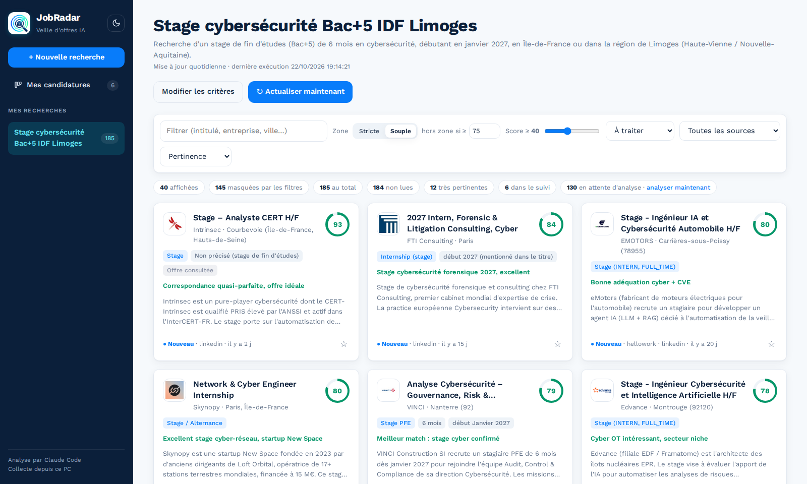
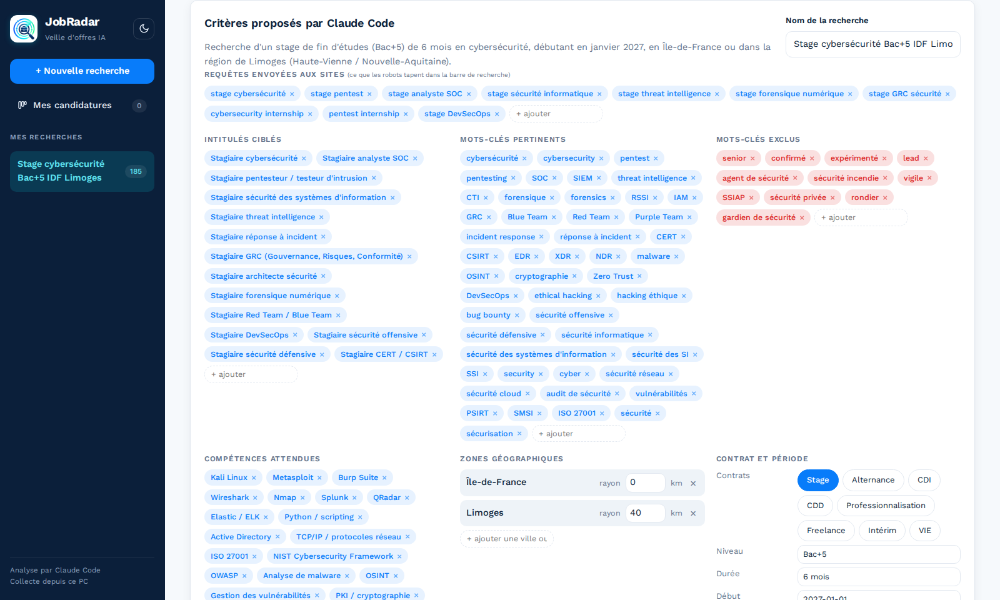
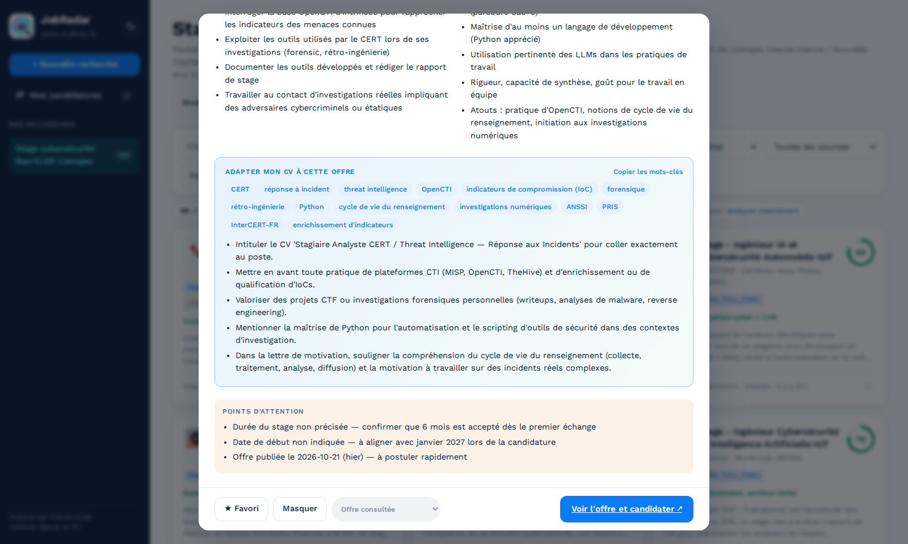
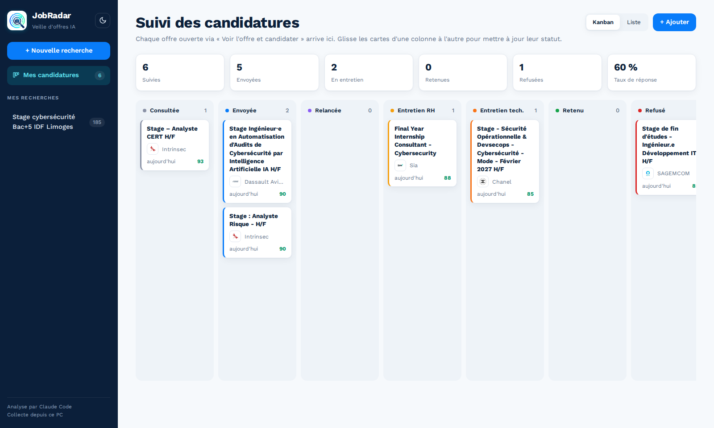
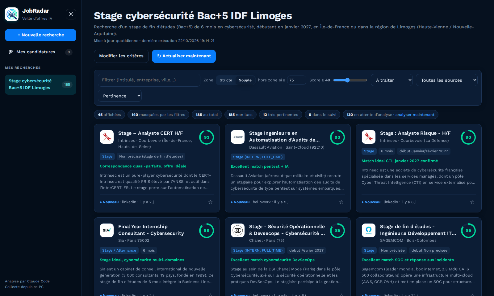
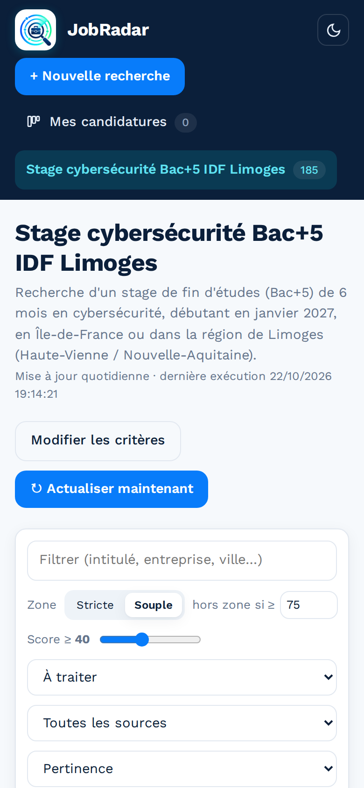
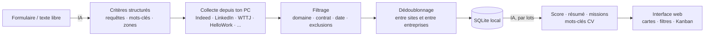

<div align="center">


# JobRadar

**Ton radar personnel d'offres de stage, d'alternance et d'emploi, analysé par IA, entièrement sur ton PC.**


[](LICENSE)

</div>



## Pourquoi JobRadar ?

Chercher un stage, c'est ouvrir dix sites, retaper les mêmes mots-clés, retomber sur les mêmes offres
publiées partout et lire des dizaines d'annonces hors sujet. JobRadar fait ce travail pour toi :

1. **Tu décris ta recherche** avec un formulaire, une phrase (« stage bac+5 de 6 mois en cybersécurité en
   Île-de-France à partir de janvier »), ou les deux.
2. **L'IA en tire une stratégie de recherche** : requêtes FR/EN, intitulés ciblés, mots-clés du domaine,
   mots à exclure. Elle te signale aussi les contradictions. Tu valides ou tu ajustes.
3. **Des robots parcourent les sites d'offres depuis ton PC** : Indeed, LinkedIn, Welcome to the Jungle,
   HelloWork, France Travail et les pages carrières d'entreprises.
4. **Les offres sont filtrées, dédoublonnées, puis analysées par l'IA** : score de pertinence expliqué,
   résumé, missions, profil recherché et **mots-clés à reprendre dans ton CV**.
5. **Tu suis tes candidatures** dans un Kanban, de « Offre consultée » jusqu'à « Retenu ».

L'IA utilisée est **ton propre assistant en ligne de commande** (Claude Code ou Codex), déjà connecté à
ton abonnement. Pas de clé API, pas de serveur distant : tes recherches et tes candidatures restent sur ta machine.

## ✨ Fonctionnalités

| | |
|---|---|
| 🧠 **Analyse des critères par IA** | Formulaire et/ou langage naturel, puis requêtes, mots-clés et exclusions, modifiables avant lancement |
| 🌐 **Multi-sources** | Indeed · LinkedIn · Welcome to the Jungle · HelloWork · La Bonne Alternance · Arbeitnow · Remote OK · France Travail · pages carrières (Greenhouse, Lever, SmartRecruiters, Workday) · catalogue de grands groupes (Thales, Airbus, Accenture, Alten, Sanofi…) |
| 🧹 **Filtrage et dédoublonnage** | Offres hors domaine ou d'un autre type de contrat écartées avant l'IA ; une même offre publiée sur plusieurs sites n'apparaît qu'une fois, avec tous ses liens |
| 📊 **Score de pertinence expliqué** | Points forts et points faibles, résumé, missions, profil, points d'attention |
| 📝 **Aide au CV** | Mots-clés exacts de l'offre à reprendre (copiables) et conseils d'adaptation |
| 🚀 **Candidature contrôlée** | Choix des CV et lettres, amélioration d'une version par consigne libre avec nouvel aperçu, panneau manuel ou remplissage assisté sur Greenhouse, Lever, SmartRecruiters, Workday et formulaires génériques ; LinkedIn et Indeed restent manuels |
| 📍 **Zone stricte ou souple** | En mode souple, une offre hors zone reste visible si son score est élevé |
| 🗂️ **Suivi des candidatures** | Kanban par glisser-déposer, vue liste, notes, historique daté, taux de réponse |
| 🔁 **Confirmation automatique** | Quand tu reviens sur JobRadar après avoir ouvert une offre, il te demande si tu as postulé |
| ⏳ **Date limite et priorité** | Date limite de candidature extraite par l'IA (« Clôture aujourd'hui », « Bientôt close »), badge « Nouvelle », tri « À faire en priorité » |
| ⭐ **Règles par entreprise** | Entreprises favorites mises en avant ; entreprises exclues masquées et plus envoyées à l'IA ; alerte « Tu as déjà postulé chez X » |
| ↩️ **Relances guidées** | Rappel 10 jours après l'envoi, brouillon de relance rédigé par l'IA (objet et message modifiables, copie, ouverture dans ta messagerie), report ou désactivation |
| 📅 **Entretiens** | Planification dans la fiche de candidature, export vers ton agenda (`.ics`) avec rappel la veille, annulation exportable |
| 🔔 **Notifications** | Offres notées 85 ou plus, relances à faire, entretiens à venir : dans JobRadar et sur le bureau |
| 🗄️ **Archive de chaque candidature** | Un dossier par candidature dans `candidatures/`, lisible sans JobRadar : copie PDF de la page de l'offre (texte complet vérifié), capture d'écran nette (résolution doublée), texte et analyse de l'offre, entretiens. Consultable même si l'annonce est retirée |
| 📦 **Sauvegarde et export** | Sauvegarde ZIP en un clic (base, réglages, archives ; sans mot de passe), export du suivi en CSV pour Excel, badge « Annonce retirée » |
| ✉️ **Alertes par e-mail** | En option, un seul e-mail récapitulatif par actualisation sur ta propre adresse, envoyé depuis ton compte (TLS obligatoire, mot de passe dans le trousseau du système) |
| ⏰ **Mise à jour quotidienne** | systemd (Linux) ou Planificateur de tâches (Windows), rattrapée au démarrage si le PC était éteint |
| 🛟 **Résistant aux quotas** | Si ton quota IA est épuisé, les offres non analysées restent en attente et sont reprises le lendemain |
| 🌗 **Thème clair / sombre** | Interface responsive, utilisable aussi sur mobile, aux couleurs de JobRadar (Work Sans, bleu nuit, bleu radar, cyan, vert menthe) |

<table>
<tr>
<td width="50%"></td>
<td width="50%"></td>
</tr>
<tr>
<td align="center"><em>Critères générés par l'IA, modifiables avant lancement</em></td>
<td align="center"><em>Détail d'une offre : score, missions, aide au CV</em></td>
</tr>
<tr>
<td width="50%"></td>
<td width="50%"></td>
</tr>
<tr>
<td align="center"><em>Suivi des candidatures en Kanban</em></td>
<td align="center"><em>Thème sombre</em></td>
</tr>
</table>

<p align="center"><br><em>Version mobile</em></p>

## 🚀 Installation

### 1. Prérequis

- **Python 3.10 ou plus récent** : [python.org](https://www.python.org/downloads/). Sous Windows, coche
  « Add Python to PATH » pendant l'installation.
- **Un assistant IA en ligne de commande, connecté à ton compte** (un seul suffit) :

| Assistant | Abonnement | Installation | Vérification |
|---|---|---|---|
| **Claude Code** | Claude Pro / Max | [docs Claude Code](https://docs.anthropic.com/en/docs/claude-code/overview) | `claude -p "dis bonjour"` |
| **Codex CLI** | ChatGPT Plus / Pro | [github.com/openai/codex](https://github.com/openai/codex) | `codex exec "dis bonjour"` |

> Lance l'assistant une première fois dans un terminal pour te connecter. JobRadar l'utilisera ensuite
> tout seul, en arrière-plan.

### 2. Récupérer le projet et lancer

**Linux / macOS**

```bash
cd JobRadar
./run.sh
```

**Windows** : double-clique sur `run.bat`, ou dans un terminal :

```bat
cd JobRadar
run.bat
```

Le premier lancement crée l'environnement Python et installe les dépendances (1 à 2 minutes). Les
lancements suivants vérifient l'empreinte de `requirements.txt` et mettent automatiquement cet
environnement à jour si les dépendances ont changé. Ils exécutent également `pip check` et importent
les bibliothèques critiques : une installation incomplète est donc détectée même si l'empreinte n'a
pas changé. L'interface s'ouvre ensuite sur
**http://127.0.0.1:8765**.

La copie des pages d'offres utilise un navigateur Chromium piloté par JobRadar. S'il n'est pas déjà présent,
le premier lancement le télécharge (environ 150 Mo). Si ce téléchargement échoue, JobRadar démarre quand
même : les offres sont alors archivées en texte, sans copie de la page.

> 🧪 JobRadar a été testé sous **Linux**. Les scripts Windows (`run.bat`, `install_daily.ps1`) et la prise
> en charge de macOS sont fournis mais n'ont pas encore été éprouvés : n'hésite pas à remonter un problème.

### 3. Choisir l'assistant IA

JobRadar prend en charge **Claude Code et Codex CLI**. Le sélecteur « Analyse avec », en bas de la barre
latérale, permet de changer d'assistant sans modifier de fichier ni redémarrer l'application. Le choix est
enregistré dans `data/config.json` et s'applique aux prochaines analyses de critères, d'offres et de documents.

Une option est désactivée lorsque sa commande n'est pas installée. Lance l'assistant une première fois dans
un terminal pour terminer sa connexion. Les utilisateurs avancés peuvent toujours choisir le modèle par tâche
dans `"models"` ; une chaîne vide utilise le modèle par défaut de l'assistant sélectionné.

## 🧭 Utilisation

1. **+ Nouvelle recherche** : remplis le formulaire et/ou décris ta recherche, puis clique sur **Analyser**.
2. **Vérifie les critères proposés** : supprime ou ajoute des requêtes, des mots-clés ou des zones (touche Entrée pour ajouter).
3. **Enregistrer et lancer la recherche** : la collecte prend 15 à 30 minutes (les robots marquent des
   pauses pour ne pas surcharger les sites). Les cartes apparaissent au fil de l'analyse.
4. **Clique sur une carte**, puis sur **Candidater** : JobRadar ajoute l'offre au suivi et te laisse choisir
   les versions validées de ton CV et de ta lettre. Seuls les documents marqués « prêts à envoyer » sont proposés.
5. **En mode manuel**, utilise le panneau d'aide pour télécharger les documents choisis et copier tes coordonnées
   ou tes réponses types. Confirme l'envoi seulement après avoir réellement soumis le formulaire.
6. **Fais glisser tes candidatures** d'une colonne à l'autre au fil des réponses (entretien RH, technique, retenu, refusé…).
7. **Relance et prépare tes entretiens** : le bandeau « À relancer » du suivi propose un brouillon de relance ; la fiche
   d'une candidature permet d'ajouter un entretien et de l'exporter vers ton agenda.
8. **Garde un œil sur la cloche** 🔔 : elle signale les offres très pertinentes, les relances à faire et les entretiens du lendemain.
   Pour les recevoir aussi par e-mail, ouvre **Réglages** (engrenage, en bas de la barre latérale).

> 💡 Le filtre « Score ≥ 40 » masque par défaut les offres peu pertinentes et celles pas encore analysées.
> Mets-le à 0 pour tout voir.

## ⏰ Mise à jour automatique quotidienne

Seules les recherches réglées sur **« Quotidienne »** sont actualisées. Le bouton **Actualiser maintenant**
fonctionne pour toutes.

**Linux** (timer systemd utilisateur ; une notification de bureau signale les nouvelles offres) :

```bash
./install_daily.sh 08:00
journalctl --user -u jobradar.service      # journal des exécutions
```

Le script accepte une heure au format strict `HH:MM`, vérifie l'installation locale, puis crée ou met à
jour de façon idempotente les unités dans `~/.config/systemd/user`. Il nécessite une distribution Linux
avec une session utilisateur systemd ; il ne convient pas à macOS. Quand `systemd-analyze` est disponible,
la syntaxe des deux unités est vérifiée avant installation. Si le rechargement ou l'activation échoue,
les fichiers et l'état précédents du timer sont restaurés au mieux.

> La validation complète du timer dépend de systemd : sur une installation minimale dépourvue de
> `systemd-analyze`, le script effectue les contrôles locaux puis laisse `systemctl --user daemon-reload`
> valider les unités. La restauration ne peut pas compenser une panne générale de la session systemd,
> mais les anciens fichiers d'unités sont remis en place avant de signaler l'erreur.

**Windows** (Planificateur de tâches, dans PowerShell) :

```powershell
powershell -ExecutionPolicy Bypass -File .\install_daily.ps1 -At 08:00
```

Le script vérifie l'environnement Python et crée ou remplace uniquement la tâche nommée `JobRadar`.
Il peut être relancé pour modifier son heure ou le chemin du projet.

Si le PC est éteint à l'heure prévue, l'exécution est rattrapée au prochain démarrage. Sur **macOS**,
lance `python -m jobradar.cli refresh` depuis une tâche `launchd` ou `cron`.

## ✉️ Alertes par e-mail

Désactivées par défaut. Une fois activées, chaque actualisation (bouton ou mise à jour quotidienne) envoie
**un seul e-mail récapitulatif** s'il y a du nouveau : offres très pertinentes (intitulé, entreprise, score,
verdict, trois raisons, lien), relances à faire et entretiens à venir. L'e-mail ne contient jamais ton CV,
tes lettres ni tes notes, et aucune image distante (pas de pixel de suivi).

1. Ouvre **Réglages** → **Alertes par e-mail**.
2. Indique ton **adresse de réception**, choisis ton **fournisseur** (Gmail, Outlook / Hotmail, Orange, Free ou
   Autre : le serveur, le port et la sécurité sont préremplis), puis ton **identifiant** et ton **mot de passe**.
3. Clique sur **Envoyer un e-mail de test** (les réglages sont enregistrés avant l'essai), puis active
   l'interrupteur et **Enregistre**.

| Fournisseur | Serveur | Port · sécurité | Remarque |
|---|---|---|---|
| Gmail | `smtp.gmail.com` | 587 · STARTTLS | Exige un [mot de passe d'application](https://myaccount.google.com/apppasswords), disponible seulement avec la validation en deux étapes ; ton mot de passe Google habituel est refusé |
| Outlook / Hotmail | `smtp-mail.outlook.com` | 587 · STARTTLS | Les comptes personnels n'acceptent plus l'envoi par mot de passe, même d'application (Microsoft exige OAuth) : envoie depuis une autre adresse ; la réception sur Outlook reste possible |
| Orange | `smtp.orange.fr` | 465 · SSL | Adresse et mot de passe de ta messagerie Orange |
| Free | `smtp.free.fr` | 465 · SSL | Adresse et mot de passe de ta messagerie Free |

Ces préréglages sont indicatifs : en cas d'échec, compare-les avec l'aide de ton fournisseur. Le message
d'erreur du test (authentification refusée, serveur introuvable, délai dépassé, certificat invalide…) indique
la piste à suivre.

- **Chiffrement obligatoire** : STARTTLS (587) ou SSL (465) avec vérification du certificat. Si le serveur ne
  propose pas STARTTLS, rien n'est envoyé (jamais d'envoi en clair).
- **Mot de passe** : jamais écrit dans `config.json` ni renvoyé par l'interface. Il est lu dans l'ordre :
  variable d'environnement `JOBRADAR_SMTP_PASSWORD`, puis **trousseau du système** (Windows, macOS, Secret Service
  sous Linux), puis `data/secrets.json` (droits 0600), qui ne sert de repli que si le trousseau est
  indisponible ; l'interface l'affiche alors clairement.
- **Mise à jour quotidienne sous Linux** : le timer systemd peut ne pas accéder à un trousseau verrouillé
  (session fermée). L'erreur « Mot de passe SMTP introuvable » apparaît alors dans Réglages et dans
  `journalctl --user -u jobradar.service` ; définis `JOBRADAR_SMTP_PASSWORD` pour le service
  (`systemctl --user edit jobradar.service`, section `[Service]`, ligne `Environment=…`) si besoin.
- **Jamais bloquant** : un échec d'envoi est journalisé et l'alerte est reprise à l'exécution suivante, trois
  tentatives au plus. La recherche, elle, se termine normalement. Un e-mail de test au plus toutes les 10 s.
- Une alerte déjà lue ou ignorée dans JobRadar n'est pas envoyée par e-mail.

## ⚙️ Configuration (`data/config.json`)

| Clé | Rôle | Défaut |
|---|---|---|
| `ai_provider` | `"claude"` ou `"codex"` | `"claude"` |
| `models` | Modèle par assistant et par tâche (`criteria`, `scoring`) | sonnet / défaut Codex |
| `scoring_batch_size` · `scoring_parallel` | Offres par appel IA · appels simultanés | 4 · 3 |
| `archive_dir` | Dossier des archives de candidatures (vide = `candidatures/` dans le projet). Un dossier synchronisé (OneDrive, Nextcloud…) en fait une sauvegarde automatique | `""` |
| `timezone` | Fuseau horaire utilisé pour les dates limites, relances et entretiens | `"Europe/Paris"` |
| `follow_up_delay_days` | Jours après l'envoi avant de proposer une relance | 10 |
| `deadline_urgent_days` | Une date limite dans ce nombre de jours passe en tête du tri « À faire en priorité » | 7 |
| `alerts` | `min_score` : score à partir duquel une offre est signalée ; `desktop` : notifications de bureau | 85 · `true` |
| `application` | Préférences du parcours de candidature : `mode`, lettre incluse et validation avant envoi (`first_five`, `always` ou `never`) | manuel · lettre incluse · `first_five` |
| `email` | Alertes par e-mail (modifiables dans **Réglages**) : `enabled`, `to`, `from` (vide = identifiant), `smtp_host`, `smtp_port`, `security` (`"starttls"` ou `"ssl"`), `username`, `kinds` (types d'alerte envoyés). Jamais de mot de passe ici | désactivé · 587 · `"starttls"` · les 3 types |
| `max_offers_scored_per_run` | Plafond d'offres analysées par exécution (préserve ton quota) | 150 |
| `results_per_query` | Résultats demandés par requête et par site | 25 |
| `sources` | Active ou désactive chaque source | toutes sauf France Travail et La Bonne Alternance |
| `francetravail` | `client_id` / `client_secret` gratuits sur [francetravail.io](https://francetravail.io) (API « Offres d'emploi v2 ») | vide |
| `labonnealternance` | `api_key` de lecture créée sur [l'espace développeurs officiel](https://api.apprentissage.beta.gouv.fr/) | vide |
| `companies` | Entreprises à surveiller directement : `{"name", "ats", "slug", "logo"}` (Workday : `host` et `site` à la place de `slug`) | 5 exemples |

**Grands groupes** : la source `grands_groupes` interroge une quarantaine de groupes qui recrutent beaucoup en France
(Thales, Airbus, Accenture, Sanofi, Air Liquide, Valeo, Michelin, Stellantis, Alten, Assystem, Sopra Steria…), listés
dans `jobradar/sources/groups.py`. Sur Workday, JobRadar lance une recherche par requête de ta recherche, puis ne garde
que les offres situées dans tes zones. Les groupes sans API carrières ouverte (Capgemini, Orange, Société Générale…)
restent couverts par LinkedIn, Indeed, HelloWork et Welcome to the Jungle. Compte quelques minutes de collecte en plus.

**Ajouter une entreprise** : ouvre sa page carrières et regarde l'URL des offres.

| URL de la page carrières | `ats` | `slug` |
|---|---|---|
| `boards.greenhouse.io/doctolib` | `greenhouse` | `doctolib` |
| `jobs.lever.co/qonto` | `lever` | `qonto` |
| `jobs.smartrecruiters.com/Devoteam` | `smartrecruiters` | `Devoteam` |
| `thales.wd3.myworkdayjobs.com/Careers` | `workday` | `"host": "thales.wd3.myworkdayjobs.com", "site": "Careers"` |

> 💸 **Quota** : une exécution complète représente quelques dizaines d'appels à l'IA. Avec Claude Code,
> `"haiku"` comme modèle de `scoring` est plus rapide et plus économe.

> 🧪 **Tester sans toucher à tes données** : la variable d'environnement `JOBRADAR_DATA_DIR` (chemin absolu)
> remplace le dossier `data/`, par exemple pour lancer JobRadar sur une copie de ta base.

## 🔧 Comment ça marche



- **Filtrage avant l'IA** : une offre n'est analysée que si son intitulé contient un mot-clé du domaine (ou
  sa description plusieurs) et, pour un stage ou une alternance, si le type de contrat correspond. Ça
  évite de dépenser ton quota sur des offres hors sujet.
- **Dédoublonnage** : les intitulés sont normalisés (accents, « H/F », « Ingénieur(e) »…) et comparés par
  entreprise. Un intitulé identique republié par un cabinet est aussi reconnu.
- **Reprise automatique** : une offre n'est marquée « analysée » qu'une fois l'analyse enregistrée. En cas
  de quota épuisé, de délai dépassé ou d'erreur, elle reste « en attente » et sera reprise à l'exécution
  suivante. Le bouton **analyser maintenant** permet aussi de relancer l'analyse sans refaire la collecte.
- **Sécurité** : l'assistant IA est lancé sans aucun outil (Claude Code `--tools ""`, Codex en bac à sable
  lecture seule). Il lit seulement le texte des offres et répond en JSON.

## 🔒 Confidentialité et usage responsable

- Tout reste sur ton PC : la base `data/jobradar.db` contient tes recherches, les offres et tes
  candidatures. Seul le texte des offres et tes critères sont envoyés à l'assistant IA que tu as choisi.
- Indeed et LinkedIn interdisent la collecte automatisée dans leurs conditions d'utilisation. JobRadar
  consulte leurs pages publiques **sans connexion**, à faible volume et avec des pauses, pour un **usage
  personnel**. Un blocage temporaire reste possible ; les autres sources continuent alors de fonctionner.
  Ne l'utilise pas pour de la collecte massive.
- La Bonne Alternance est réservée aux usages non commerciaux. Arbeitnow et Remote OK imposent de conserver
  leur attribution et un lien vers l'annonce d'origine ; JobRadar les affiche comme source de chaque offre.
- L'API France Travail peut être temporairement restreinte. Son absence n'interrompt jamais les autres sources.
- JobTeaser et l'APEC ne sont pas pris en charge : leurs offres sont derrière une connexion (école) ou une
  protection anti-robot.

## 🩺 Dépannage

| Problème | Solution |
|---|---|
| « Commande `claude` / `codex` introuvable » | Vérifie que la commande fonctionne dans un terminal ; sinon, indique son chemin complet dans `claude_bin` / `codex_bin` de `data/config.json` |
| Beaucoup d'offres « en attente d'analyse » | Quota atteint ou plafond par exécution : clique sur **analyser maintenant** plus tard, ou attends l'actualisation du lendemain |
| Une source renvoie 0 offre ou une erreur | Le site a pu changer ou te bloquer temporairement : consulte le **journal** pendant l'actualisation et désactive la source dans `sources` si besoin |
| Aucune carte affichée | Baisse le filtre de score à 0 et passe la zone en « Souple » |
| Le port 8765 est déjà utilisé | `run.sh --port 8780` (ou `run.bat --port 8780`) |
| Python est annoncé introuvable | Installe Python 3.10 ou plus récent. Sous Linux, installe aussi le paquet `python3-venv` si la création de `.venv` échoue |
| Les dépendances ne s'installent pas | Vérifie la connexion, puis relance `run.sh` ou `run.bat` : l'installation reprend sans toucher aux données utilisateur |
| La planification Linux échoue | Vérifie que `systemctl --user status` fonctionne ; certains conteneurs et environnements sans systemd ne prennent pas en charge le timer |

## 🗺️ Feuille de route

Le plan détaillé est dans [docs/etude-faisabilite-cv-lettre.md](docs/etude-faisabilite-cv-lettre.md) (section 11).

- [x] **Étape 1** : dates limites et priorité, règles par entreprise, alertes, relances guidées, entretiens dans l'agenda, qualité du dépôt
- [x] **Étape 2** : archivage local de chaque candidature (copie PDF et capture de l'offre), sauvegarde et export
- [x] **Étape 3** : profil candidat, CV et lettre adaptés à chaque offre, contrôle ATS
- [ ] **Étape 4** : préparation et simulation d'entretien, statistiques de candidature
- [x] **Étape 5** : candidature manuelle ou assistée par IA — Greenhouse, Lever, SmartRecruiters, Workday et formulaires génériques ; reprise humaine sûre, preuves et repli manuel
- [x] **Étape 6** : conservation du DOCX d’origine, reproduction ATS approchée du style d’un PDF Canva/Figma et modèle LaTeX ATS sécurisé avec repli automatique
- [ ] **Étape 7** : installateur, interface en anglais, clé API IA externe en option

## 📁 Structure du projet

```
JobRadar/
├── run.sh · run.bat              # lancement (Linux/macOS · Windows)
├── install_daily.sh · .ps1       # actualisation quotidienne (systemd · Planificateur de tâches)
├── requirements.txt
├── jobradar/
│   ├── server.py                 # API web (FastAPI)
│   ├── pipeline.py               # collecte → filtrage → dédoublonnage → analyse
│   ├── matching.py               # règles de pertinence et de dédoublonnage
│   ├── ai.py                     # appels à Claude Code / Codex, prompts et schémas JSON
│   ├── db.py                     # stockage SQLite
│   ├── migrations.py             # évolutions versionnées du schéma de la base
│   ├── workflow.py               # règles de priorité, dates limites et relances
│   ├── notifications.py          # alertes dans l'application, sur le bureau et récapitulatif e-mail
│   ├── mailer.py                 # e-mail : réglages, mot de passe (trousseau), message, envoi SMTP chiffré
│   ├── calendar_export.py        # export des entretiens (.ics)
│   ├── archive.py                # dossiers d'archives des candidatures
│   ├── capture.py                # copie PDF et capture d'écran des pages d'offres
│   ├── export.py                 # export CSV et sauvegarde ZIP
│   ├── cli.py                    # serve · refresh
│   ├── sources/                  # un collecteur par site
│   └── static/                   # interface (HTML/CSS/JS, sans build)
├── tests/                        # tests automatisés (pytest)
├── docs/                         # étude, logo, captures
├── candidatures/                 # créé à l'usage : un dossier par candidature (ignoré par git)
└── data/                         # créé au lancement : base, configuration, secrets.json éventuel (ignoré par git)
```

## 📄 Licence

JobRadar est distribué sous [licence MIT](LICENSE) : tu peux l'utiliser, le modifier et le partager librement,
y compris pour un usage commercial, à condition de conserver la mention de copyright et de licence.
